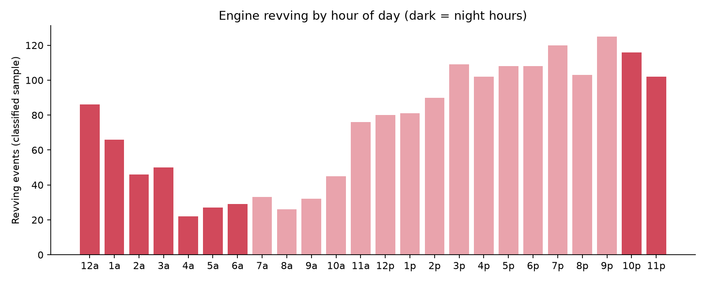

# Residential Street Noise Monitor (Atlanta)

Two months of continuous sound monitoring from an apartment on a residential street in Atlanta, GA,
collected to document **cars loudly revving their engines, especially late at night**.

Recorded with [sound-monitor](https://github.com/DrewThomasson/sound-monitor), an open-source app
that records audio around the clock and logs every sound that crosses a loudness threshold as an
"event", saving a short audio clip and a video of each one.

> **Second site:** recording continues from a 5th-floor porch next door starting November 2026, in
> [drewThomasson/sound-monitor-porch](https://huggingface.co/datasets/drewThomasson/sound-monitor-porch).

| | |
|---|---|
| **Period** | Nov 10, 2025 – Jan 13, 2026 (65 days) |
| **Monitoring uptime** | 95.5% (89,400 one-minute recordings) |
| **Loud events logged** | 11,291 (about 174 per day) |
| **Engine revving events** | **1,782**, with sirens excluded |
| **Revving at night (10 PM – 7 AM)** | **544**, on 63 of 65 nights |
| **Revving between midnight and 5 AM** | 270 |

## Key findings

**Revving happens almost every night, and weekends are much worse.**
Saturdays had 420 revving events, compared with 150 on Mondays. Friday and Saturday nights account
for 282 of the 544 nighttime events.

| Mon | Tue | Wed | Thu | Fri | Sat | Sun |
|---|---|---|---|---|---|---|
| 150 | 188 | 250 | 222 | 248 | **420** | 304 |

**The worst nights** were Sat Nov 22 (33 revving events), Sat Dec 13 (31), Sat Jan 10 (29),
Fri Nov 21 (23), New Year's Eve (22) and Fri Dec 5 (22).

**The busiest hours** are 7–11 PM, with a second cluster from midnight to 4 AM on Saturday nights.

### Patterns

- **Friday and Saturday nights average 15.7 revving events, about 3 times the 5.6 on other nights.**
- **Saturday nights run late.** Early Sunday morning (midnight – 4 AM) had 95 revving events,
  compared with about 19 for the same hours on an average weekday.
- **Revving makes up a larger share of the noise at night:** 19% of loud events at night, 15% during the day.
- **It comes in bursts.** A third of revving events (603 of 1,782) came within 5 minutes of another one,
  which suggests the same driver making repeated passes or revving in place. The longest burst
  was 9 events in 4 minutes (Dec 27, 6:22 PM), and the longest at night was 7 events in 10 minutes
  (Sat Jan 10, 10:13 PM).
- **It's steady, not a one-off.** Revving averaged 25–30 events per day in each of November,
  December and January.
- **The only full night with no revving was Thanksgiving Eve** (Nov 26). The monitor was running
  the whole night and logged 62 other loud events.
- For comparison, the monitor heard about 10 emergency sirens per day. Those are counted separately
  and excluded from all revving numbers.





## Listen for yourself

Example events from each group, with the recorded sound merged into each video. Within each group, these are the clips the model was most confident about.

### Loudest nighttime revving (10 PM – 7 AM)

<figure style="display:inline-block;width:300px;margin:0 8px 16px 0;vertical-align:top"><video controls preload="metadata" width="300" src="https://huggingface.co/datasets/drewThomasson/sound-monitor-data/resolve/main/analysis/examples/7678.mp4"></video><figcaption>Wed Dec 24, 10:18 PM · 93.9 dB</figcaption></figure><figure style="display:inline-block;width:300px;margin:0 8px 16px 0;vertical-align:top"><video controls preload="metadata" width="300" src="https://huggingface.co/datasets/drewThomasson/sound-monitor-data/resolve/main/analysis/examples/785.mp4"></video><figcaption>Fri Nov 14, 10:58 PM · 93.8 dB</figcaption></figure><figure style="display:inline-block;width:300px;margin:0 8px 16px 0;vertical-align:top"><video controls preload="metadata" width="300" src="https://huggingface.co/datasets/drewThomasson/sound-monitor-data/resolve/main/analysis/examples/1365.mp4"></video><figcaption>Tue Nov 18, 12:23 AM · 93.8 dB</figcaption></figure><figure style="display:inline-block;width:300px;margin:0 8px 16px 0;vertical-align:top"><video controls preload="metadata" width="300" src="https://huggingface.co/datasets/drewThomasson/sound-monitor-data/resolve/main/analysis/examples/2297.mp4"></video><figcaption>Sat Nov 22, 11:51 PM · 93.8 dB</figcaption></figure><figure style="display:inline-block;width:300px;margin:0 8px 16px 0;vertical-align:top"><video controls preload="metadata" width="300" src="https://huggingface.co/datasets/drewThomasson/sound-monitor-data/resolve/main/analysis/examples/7566.mp4"></video><figcaption>Wed Dec 24, 2:01 AM · 93.8 dB</figcaption></figure><figure style="display:inline-block;width:300px;margin:0 8px 16px 0;vertical-align:top"><video controls preload="metadata" width="300" src="https://huggingface.co/datasets/drewThomasson/sound-monitor-data/resolve/main/analysis/examples/264.mp4"></video><figcaption>Wed Nov 12, 3:18 AM · 93.8 dB</figcaption></figure>

### Engine revving

<figure style="display:inline-block;width:300px;margin:0 8px 16px 0;vertical-align:top"><video controls preload="metadata" width="300" src="https://huggingface.co/datasets/drewThomasson/sound-monitor-data/resolve/main/analysis/examples/10549.mp4"></video><figcaption>Sat Jan 10, 9:09 PM · 93.6 dB</figcaption></figure><figure style="display:inline-block;width:300px;margin:0 8px 16px 0;vertical-align:top"><video controls preload="metadata" width="300" src="https://huggingface.co/datasets/drewThomasson/sound-monitor-data/resolve/main/analysis/examples/3171.mp4"></video><figcaption>Fri Nov 28, 10:19 PM · 92.3 dB</figcaption></figure><figure style="display:inline-block;width:300px;margin:0 8px 16px 0;vertical-align:top"><video controls preload="metadata" width="300" src="https://huggingface.co/datasets/drewThomasson/sound-monitor-data/resolve/main/analysis/examples/7521.mp4"></video><figcaption>Tue Dec 23, 3:47 PM · 93.8 dB</figcaption></figure><figure style="display:inline-block;width:300px;margin:0 8px 16px 0;vertical-align:top"><video controls preload="metadata" width="300" src="https://huggingface.co/datasets/drewThomasson/sound-monitor-data/resolve/main/analysis/examples/8248.mp4"></video><figcaption>Sun Dec 28, 9:06 PM · 93.7 dB</figcaption></figure>

### Emergency sirens (excluded from revving)

<figure style="display:inline-block;width:300px;margin:0 8px 16px 0;vertical-align:top"><video controls preload="metadata" width="300" src="https://huggingface.co/datasets/drewThomasson/sound-monitor-data/resolve/main/analysis/examples/2861.mp4"></video><figcaption>Wed Nov 26, 3:04 PM · 93.6 dB</figcaption></figure><figure style="display:inline-block;width:300px;margin:0 8px 16px 0;vertical-align:top"><video controls preload="metadata" width="300" src="https://huggingface.co/datasets/drewThomasson/sound-monitor-data/resolve/main/analysis/examples/1158.mp4"></video><figcaption>Sun Nov 16, 3:16 PM · 93.8 dB</figcaption></figure><figure style="display:inline-block;width:300px;margin:0 8px 16px 0;vertical-align:top"><video controls preload="metadata" width="300" src="https://huggingface.co/datasets/drewThomasson/sound-monitor-data/resolve/main/analysis/examples/3855.mp4"></video><figcaption>Thu Dec 4, 6:10 PM · 93.8 dB</figcaption></figure><figure style="display:inline-block;width:300px;margin:0 8px 16px 0;vertical-align:top"><video controls preload="metadata" width="300" src="https://huggingface.co/datasets/drewThomasson/sound-monitor-data/resolve/main/analysis/examples/10314.mp4"></video><figcaption>Fri Jan 9, 6:10 AM · 93.7 dB</figcaption></figure>

### Horns and car alarms

<figure style="display:inline-block;width:300px;margin:0 8px 16px 0;vertical-align:top"><video controls preload="metadata" width="300" src="https://huggingface.co/datasets/drewThomasson/sound-monitor-data/resolve/main/analysis/examples/8180.mp4"></video><figcaption>Sun Dec 28, 8:33 AM · 92.1 dB</figcaption></figure><figure style="display:inline-block;width:300px;margin:0 8px 16px 0;vertical-align:top"><video controls preload="metadata" width="300" src="https://huggingface.co/datasets/drewThomasson/sound-monitor-data/resolve/main/analysis/examples/8179.mp4"></video><figcaption>Sun Dec 28, 8:33 AM · 92.1 dB</figcaption></figure><figure style="display:inline-block;width:300px;margin:0 8px 16px 0;vertical-align:top"><video controls preload="metadata" width="300" src="https://huggingface.co/datasets/drewThomasson/sound-monitor-data/resolve/main/analysis/examples/1181.mp4"></video><figcaption>Sun Nov 16, 6:08 PM · 92.0 dB</figcaption></figure><figure style="display:inline-block;width:300px;margin:0 8px 16px 0;vertical-align:top"><video controls preload="metadata" width="300" src="https://huggingface.co/datasets/drewThomasson/sound-monitor-data/resolve/main/analysis/examples/4685.mp4"></video><figcaption>Wed Dec 10, 1:21 PM · 91.5 dB</figcaption></figure>

### Other vehicle noise

<figure style="display:inline-block;width:300px;margin:0 8px 16px 0;vertical-align:top"><video controls preload="metadata" width="300" src="https://huggingface.co/datasets/drewThomasson/sound-monitor-data/resolve/main/analysis/examples/6755.mp4"></video><figcaption>Thu Dec 18, 1:24 PM · 92.9 dB</figcaption></figure><figure style="display:inline-block;width:300px;margin:0 8px 16px 0;vertical-align:top"><video controls preload="metadata" width="300" src="https://huggingface.co/datasets/drewThomasson/sound-monitor-data/resolve/main/analysis/examples/3701.mp4"></video><figcaption>Wed Dec 3, 1:29 PM · 93.0 dB</figcaption></figure><figure style="display:inline-block;width:300px;margin:0 8px 16px 0;vertical-align:top"><video controls preload="metadata" width="300" src="https://huggingface.co/datasets/drewThomasson/sound-monitor-data/resolve/main/analysis/examples/3818.mp4"></video><figcaption>Thu Dec 4, 12:00 PM · 93.0 dB</figcaption></figure><figure style="display:inline-block;width:300px;margin:0 8px 16px 0;vertical-align:top"><video controls preload="metadata" width="300" src="https://huggingface.co/datasets/drewThomasson/sound-monitor-data/resolve/main/analysis/examples/8198.mp4"></video><figcaption>Sun Dec 28, 12:14 PM · 93.2 dB</figcaption></figure>

### Other sounds

<figure style="display:inline-block;width:300px;margin:0 8px 16px 0;vertical-align:top"><video controls preload="metadata" width="300" src="https://huggingface.co/datasets/drewThomasson/sound-monitor-data/resolve/main/analysis/examples/10391.mp4"></video><figcaption>Fri Jan 9, 3:25 PM · 91.1 dB</figcaption></figure><figure style="display:inline-block;width:300px;margin:0 8px 16px 0;vertical-align:top"><video controls preload="metadata" width="300" src="https://huggingface.co/datasets/drewThomasson/sound-monitor-data/resolve/main/analysis/examples/4341.mp4"></video><figcaption>Sun Dec 7, 3:01 PM · 92.8 dB</figcaption></figure><figure style="display:inline-block;width:300px;margin:0 8px 16px 0;vertical-align:top"><video controls preload="metadata" width="300" src="https://huggingface.co/datasets/drewThomasson/sound-monitor-data/resolve/main/analysis/examples/5393.mp4"></video><figcaption>Sun Dec 14, 6:30 AM · 92.6 dB</figcaption></figure><figure style="display:inline-block;width:300px;margin:0 8px 16px 0;vertical-align:top"><video controls preload="metadata" width="300" src="https://huggingface.co/datasets/drewThomasson/sound-monitor-data/resolve/main/analysis/examples/4787.mp4"></video><figcaption>Thu Dec 11, 5:15 AM · 92.1 dB</figcaption></figure>

### What the loud events were

| Type | Events | Share |
|---|---|---|
| Vehicle noise (other than revving) | 6,491 | 57.7% |
| Other sounds | 2,199 | 19.5% |
| **Engine revving** | **1,782** | **15.8%** |
| Emergency sirens (excluded from revving) | 669 | 5.9% |
| Horns and car alarms | 108 | 1.0% |


## How events were labeled

Each event clip was scored with the
[Audio Spectrogram Transformer](https://huggingface.co/MIT/ast-finetuned-audioset-10-10-0.4593)
trained on Google's AudioSet. Its 527 sound classes were grouped, and each clip got one label,
checked in this order:

1. **Siren**: police, ambulance, fire truck, civil defense siren or emergency vehicle (score of at least 0.15).
   Sirens come first, so emergency vehicles never count as revving.
2. **Horn**: car horn, truck horn or car alarm (score of at least 0.30).
3. **Revving**: "Accelerating, revving, vroom", racing, motorcycle, skidding or tire squeal
   (score of at least 0.20), or strong engine noise where the revving score is at least half the engine score.
4. **Vehicle**: any other car, truck, bus or engine sound (score of at least 0.20).
5. **Other**: everything else.

A random sample of the labels was spot-checked by ear before the full run.

## Limitations

- **The decibel values are not calibrated.** They come from a consumer microphone and are useful for
  comparing events with each other, not for comparing against legal dBA limits.
- **The labels are a model's best guess.** Not every clip was checked by hand, so expect some
  mistakes in every category.
- **42 events have no audio clip** in this dataset, so they are unlabeled.
- Night is defined here as 10 PM – 7 AM.

## Dataset layout

```
sound_events.db                                  SQLite log of every event
recordings/YYYY-MM-DD/YYYYMMDD_HHMMSS.mp3        continuous 1-minute recordings
recordings/YYYY-MM-DD/event_<timestamp>.mp3      audio clip of each loud event
videos/YYYY-MM-DD/event_<timestamp>.mp4          video of each loud event (no audio track)
analysis/                                        the charts and example videos on this page
```

`sound_events.db` has one table, `events`:

| Column | Meaning |
|---|---|
| `id` | event number |
| `timestamp` | start time, local (Eastern) time |
| `duration` | seconds |
| `peak_db`, `avg_db` | peak and average level (uncalibrated) |
| `low_frequency` | whether the event was dominated by low frequencies |
| `filename` | path to the event's audio clip |
| `video_filename` | path to the event's video |

To fetch only the database and event clips, without the 43 GB of continuous recordings:

```python
from huggingface_hub import snapshot_download
snapshot_download("drewThomasson/sound-monitor-data", repo_type="dataset",
                  allow_patterns=["sound_events.db", "recordings/*/event_*.mp3"])
```

## Privacy

The recordings capture a public street. Clips and videos may include passing voices, faces or
license plates. Please don't use this data to identify individuals.
